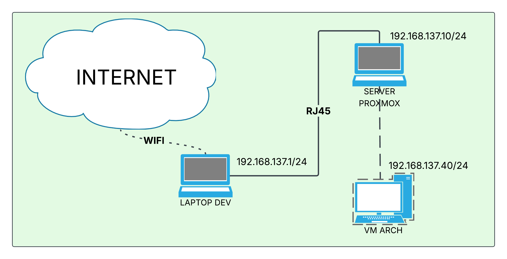
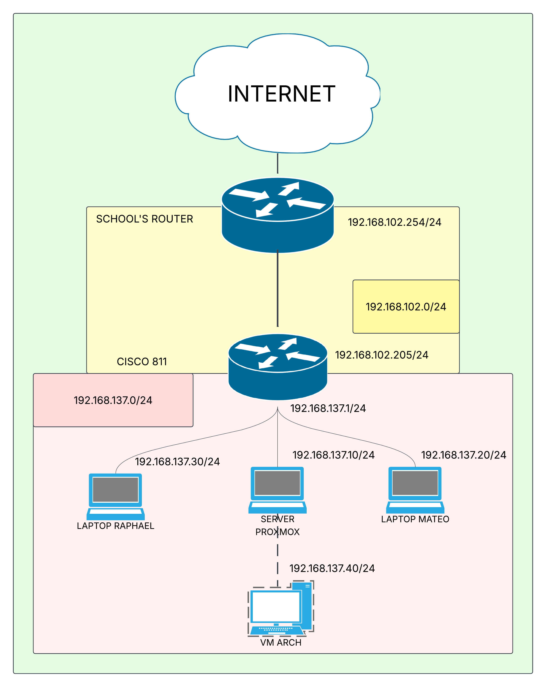

# Infrastructure Setup

This document details the complete infrastructure setup used for the development of the ISIMA Purple Linux System (IPLS). It notably details:
- The network infrastructure
- The router configuration
- The IP addresses mapping
- The configuration of the Proxmox server and its hosted Arch Linux VM.

## Network Infrastructure

The configuration is split into two distinct architectures. The first architecture is designed for standalone work in a student residency where no ethernet connection to the ISP box is available, requiring Wi-Fi sharing. The second architecture is designed for collaborative work at school.

### Home Infrastructure

Below is the home network architecture diagram:



To provide Internet access to the Proxmox server without a direct physical link to the residential router, network connection sharing (NAT) was established from the developer laptop's Wi-Fi interface to its Ethernet interface. This setup assigns the gateway address `192.168.137.1/24` to the laptop's Ethernet interface.

The Proxmox host is configured with the static IP `192.168.137.10/24`, while the hosted Arch Linux VM uses `192.168.137.40/24`.

#### Workstation Network Sharing Configuration

Depending on the operating system running on the developer workstation, connection sharing is enabled using the respective methods below:

##### Windows (Internet Connection Sharing)
1. Open the **Network Connections** manager (`Win + R` $\rightarrow$ `ncpa.cpl`).
2. Right-click the active **Wi-Fi** adapter and select **Properties**.
3. Switch to the **Sharing** tab.
4. Check *"Allow other network users to connect through this computer's Internet connection"*.
5. Select the physical Ethernet interface connected to the Proxmox server from the drop-down menu and apply the changes.

> **Note:** Windows Internet Connection Sharing (ICS) automatically sets the host Ethernet interface IP address to `192.168.137.1/24`.

-------------

##### Linux (CLI / iptables) 
> **Note** : Following instructions were created for Debian12
1. Enable IPv4 packet forwarding in the kernel:
   ```bash
   sudo sysctl -w net.ipv4.ip_forward=1
    ```
2. Reset and configure the Ethernet gateway interface:
    ```bash
    sudo ip addr flush dev <ETH_INTERFACE>
    sudo ip addr add 192.168.137.1/24 dev <ETH_INTERFACE>
    sudo ip link set dev <ETH_INTERFACE> up
    ```
3. Configure NAT (masquerading) and traffic forwarding rules:
    ```bash
    sudo iptables -t nat -A POSTROUTING -o <WIFI_INTERFACE> -j MASQUERADE
    sudo iptables -A FORWARD -i <ETH_INTERFACE> -o <WIFI_INTERFACE> -j ACCEPT
    sudo iptables -A FORWARD -i <WIFI_INTERFACE> -o <ETH_INTERFACE> -m state --state RELATED,ESTABLISHED -j ACCEPT
    ```

> **Note on Handling Rule Conflicts:** Before applying new rules, inspect existing configurations:
> ```bash
> sudo iptables -t nat -L POSTROUTING --line-numbers -v -n
> sudo iptables -L FORWARD --line-numbers -v -n
> ```
> - **Targeted Deletion (Recommended):** Delete only the conflicting rule by specifying its chain and line number, depending on where the conflict was identified:
>   - For a forwarding rule conflict: `sudo iptables -D FORWARD <RULE_NUMBER>`
>   - For a NAT rule conflict: `sudo iptables -t nat -D POSTROUTING <RULE_NUMBER>`
>
>   This surgically removes the obstacle without affecting other active rules or security policies.
> - **Full Flush (Not Recommended):** Emptying entire chains or tables (`sudo iptables -F FORWARD` or `sudo iptables -t nat -F`) is discouraged, as it indiscriminately wipes all existing firewall rules, which may disrupt other active network services.


### School Infrastructure

Below is the school network architecture diagram:



The school provides internet access to the classroom via a main router performing NAT (Network Address Translation) for the `192.168.102.0/24` subnet. We cascaded a Cisco 881 router behind this main router, assigning it the `192.168.102.205/24` IP address on its WAN interface.

To maintain consistency with the home infrastructure, we configured the `192.168.137.1/24` IP address on the Cisco router's `Vlan1` LAN interface, acting as the gateway for the laptops and the server.

Below is the Cisco router configuration used to deploy this setup:

```bash
! 1. Basic configuration of the router
Router> enable
Router# conf terminal
! To avoid DNS resolution when mistyping a command
Router(config)# no ip domain-lookup 
! To avoid Logs to perturb the typing of the commands
Router(config)# line console 0
Router(config)#     logging synchronous
Router(config)#     exit

! 2. WAN Interface (connected to the ISIMA network)
Router(config)# interface FastEthernet4
Router(config-if)# ip address 192.168.102.205 255.255.255.0
Router(config-if)# ip nat outside
Router(config-if)# no shutdown

! 3. LAN Interface (Laptops and Server gateway)
Router(config-if)# interface Vlan1
Router(config-if)# ip address 192.168.137.1 255.255.255.0
Router(config-if)# ip nat inside
Router(config-if)# no shutdown
Router(config-if)# exit

! 4. Default route (route to the ISIMA gateway)
Router(config)# ip route 0.0.0.0 0.0.0.0 192.168.102.254

! 5. Double NAT (mandatory to mask the .137 network to the ISIMA router)
Router(config)# access-list 1 permit 192.168.137.0 0.0.0.255
Router(config)# ip nat inside source list 1 interface FastEthernet4 overload
Router(config)# exit
! 6. Copy the config into the startup-config to ensure persistence
Router# copy running-config startup-config
```

## Laptops Configuration

Static IP addresses are assigned to the developer laptops as follows:

**Mateo's Laptop:**
- **IP          :** 192.168.137.20/24
- **Subnet Mask :** 255.255.255.0
- **Gateway     :** 192.168.137.1
- **DNS         :** 8.8.8.8

**Raphael's Laptop:**
- **IP          :** 192.168.137.30/24
- **Subnet Mask :** 255.255.255.0
- **Gateway     :** 192.168.137.1
- **DNS         :** 8.8.8.8

## Proxmox Server Network Configuration

The Proxmox server uses a Linux bridge configuration. Ensure the `/etc/network/interfaces` file contains the following (adjust the NIC name `enx70198886dd4d` if necessary):

```bash
auto lo
iface lo inet loopback

auto enx70198886dd4d
iface enx70198886dd4d inet manual

auto vmbr0
iface vmbr0 inet static
    address 192.168.137.10/24
    gateway 192.168.137.1
    bridge-ports enx70198886dd4d
    bridge-stp off 
    bridge-fd 0

source /etc/network/interfaces.d/*
```

## Arch VM Network Configuration

The Arch Linux VM utilizes `systemd-networkd` for network management. In the `/etc/systemd/network/20-wired.network` file, ensure the following configuration is set (adjust `ens18` to match your interface name):

```ini
[Match]
Name=ens18

[Network]
Address=192.168.137.40/24
Gateway=192.168.137.1
DNS=1.1.1.1
```

*(Note: If no text editor is installed in your Arch VM during the initial setup, you can create this file using shell redirection:
```bash
cat > /etc/systemd/network/20-wired.network << "EOF"
[Match]
Name=ens18

[Network]
Address=192.168.137.40/24
Gateway=192.168.137.1
DNS=1.1.1.1
EOF
```
)*

Finally, start and enable the network manager and the DNS resolver, and link the DNS resolution file:

```bash
systemctl enable --now systemd-networkd
systemctl enable --now systemd-resolved
ln -sf /run/systemd/resolve/stub-resolv.conf /etc/resolv.conf
```